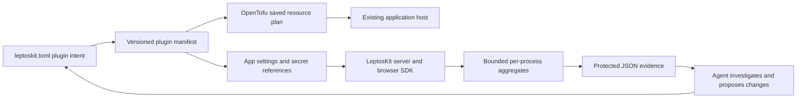

# Analytics and infrastructure plugins

Research and implementation decision, 3 November 2026. The initial embedded analytics tier is now connected to the [single-owner management service](management-service.md): durable fleet history, host samples, an actual LeptosKit dashboard and OTLP/HTTP metrics export are implemented. The broader [control-plane design](deployment-control-plane.md) still describes future multi-tenant/Kubernetes adapters.

## Decision

LeptosKit should own the application integration, configuration, deployment context, API and interface. Use open observability formats for interoperability; avoid making a new telemetry storage engine a prerequisite for a small app. Start with an optional, bounded in-process analytics capability. Later add OpenTelemetry export and independently selectable storage/collector plugins. Do not install Kubernetes or a collection of monitoring databases on every VM.

Infrastructure plugins are distinct from native runtime bridge plugins. They describe a versioned capability, provider resources, runtime services, app features, bindings, secrets, state ownership and removal policy. Agents can inspect these requirements and edit ordinary `.tf`/`.tofu` files alongside the generated configuration. `.tf` is Terraform/OpenTofu configuration, unrelated to TensorFlow.

## What existing products teach us

| Product       | Relevant behavior                                                                                                                                                                | LeptosKit decision                                                                                                                                                                        |
| ------------- | -------------------------------------------------------------------------------------------------------------------------------------------------------------------------------- | ----------------------------------------------------------------------------------------------------------------------------------------------------------------------------------------- |
| Fly.io        | Managed Prometheus-compatible queries, Grafana, automatic instance/proxy/volume metrics, and custom app metrics.                                                                 | Make observability available through both a UI and an API; distinguish host signals from app signals. A JSON endpoint without host instrumentation is not equivalent to Fly's monitoring. |
| Grafana Faro  | Browser performance, errors, events and traces; a collector forwards telemetry to backends such as Loki and Tempo. Browser telemetry can correlate with backend instrumentation. | Supply an app-aware browser integration and shared request context. Keep the backend independently instrumented. Faro remains an optional integration candidate.                          |
| OpenTelemetry | Instrumentation and collection/export protocols with separate backend storage. A host-local collector can forward to a shared backend.                                           | Prefer OTLP for the future external export adapter. Avoid a mandatory collector in the first tier.                                                                                        |
| SigNoz        | OpenTelemetry-oriented stack with ClickHouse and additional services. Its small Linux test installation asks for at least 4 GB memory.                                           | Useful larger deployment target; excessive as a required addition to the smallest application host.                                                                                       |
| GlitchTip     | Error tracking/performance/uptime product using PostgreSQL and a service; Valkey is optional. Its documented recommended memory is 512 MB, with smaller minimum configurations.  | A plausible optional error-tracking integration, especially where Sentry SDK compatibility matters. LeptosKit does not need to recreate stack-trace grouping first.                       |
| PostHog       | Product analytics and replay; documented self-host requirements include 16 GB RAM, and self-hosting is officially unsupported.                                                   | Keep product analytics/funnels and replay separate from infrastructure evidence and optional in the cost model. Do not require PostHog for basic app diagnostics.                         |

Sources: [Fly metrics](https://docs.fly.io/monitoring/metrics), [Faro OSS](https://grafana.com/oss/faro/), [OTel collector agent deployment](https://opentelemetry.io/docs/collector/deploy/agent/), [SigNoz Linux installation](https://signoz.io/docs/install/linux/), [GlitchTip installation](https://glitchtip.com/documentation/install/), [PostHog self-hosting](https://posthog.com/docs/self-host). Requirements and feature availability change; these are research observations, not price quotes or measured LeptosKit resource requirements.

The [OTel Rust project](https://open-telemetry.github.io/opentelemetry-rust/) tracks signal-specific maturity. Its documentation recommends existing logging APIs such as `tracing` rather than a new application logging API. The [JavaScript documentation](https://opentelemetry.io/docs/languages/js/) still calls browser client instrumentation experimental. Prefer an adapter over a claim that one SDK automatically instruments every LeptosKit platform.

## Shipped first slice

`leptoskit_analytics` is a publishable, dependency-light core, re-exported behind the facade's `analytics` feature. It provides:

- A fixed server-owned service/environment/release/instance identity.
- Separate backend, browser and native provenance; named HTTP/database/RPC/job/live signals.
- Fixed latency histograms in bounded minute windows, bounded active series, bounded recent correlation contexts, expiry, and collection-loss counters.
- Strict W3C version-00 `traceparent` parsing; continuation with a random server span ID and the same trace ID. Baggage and remote sampling directives are ignored.
- An optional Axum mount with matched-route request timing, a read-only bearer API, same-origin browser ingestion, body/batch/rate limits, and explicit timers.
- A browser ES module for page views, navigation duration, selected same-origin fetch duration/failure, and uncaught-error counts. Installing it and supplying route templates are explicit application steps. GPC/DNT disable collection.
- Versioned JSON evidence with counts, limitations and conservative backend error-rate investigation findings. No finding authorizes an infra mutation.
- `lk infra plugins` for the versioned built-in capability catalog and `lk infra analytics` for connected fleet history or a standalone instance's protected snapshot.

The generated `plugins.json` is included in the saved plan fingerprint. Regenerating changed plugin intent or bindings invalidates an existing saved plan; applying infrastructure again requires a new plan. App binding changes take effect on the next deployment. The plugin adds app environment bindings, a server-only read credential reference, and the actual boot version for deployment and recovery. The generated CI workflow requests that credential only when enabled. No additional VM, container, provider resource, mandatory Redis, persistent volume or monitoring database is created by the analytics plugin.

## Flow

OpenTofu changes the provider resources; Kamal rolls application containers; the application records its measurements. Adding analytics changes app bindings even if the provider-resource diff is empty. Deploy the new app configuration after reviewing the plugin change. Neither an analytics query nor a finding applies an OpenTofu plan.

The package's read endpoint keeps its own JSON evidence format. A separate OTLP/HTTP JSON delta-metrics adapter is implemented. Standard trace context provides correlation; there is no full span exporter, parent/child trace graph or log collector.

## Privacy, trust and resource budgets

Default telemetry contains no raw URLs, query strings, cookies, request bodies, response bodies, SQL text, exception messages, DOM content, user IDs or persistent session IDs. HTTP middleware uses Axum's matched route; unmatched requests share one operation. Manual timers require app-owned bounded names. Browser route names must match a server allowlist. No arbitrary properties are accepted. Applications can still leak data by inventing an unsafe operation name; agents must use static names, not encoded user input.

Public browser ingestion is not authenticated evidence. The origin check helps control browser access, but a non-browser client can forge that header. Browser series have a restricted allocation ceiling, and backend collection can evict non-backend series. Browser reports never enter backend error-rate findings. Public abuse can still consume request CPU/bandwidth, so normal edge limits remain useful. The read API uses a hashed comparison key, disables caching, and never exposes that key to the browser SDK. Analytics credentials grant no deployment/provider access. Query commands do not follow HTTP redirects.

Defaults retain 15 minute windows, at most 128 aggregate series and 64 recent contexts. The upper supported bounds are 60 windows, 512 series and 256 recent contexts. This bounds retained data, not overall server CPU or HTTP concurrency. Collection loss is visible. Memory and ingestion throughput have not been benchmarked on the proposed smallest VM; adding no service is not a promise of zero resource overhead or a guaranteed monthly bill.

The W3C specification explicitly discusses untrusted trace context and privacy: [Trace Context](https://www.w3.org/TR/trace-context/). Context is correlation, never authorization; the incoming sampled bit cannot increase our collection.

## Agent decisions

Resource release metadata identifies the server, not the client bundle or code-push release. Add explicit client build attribution before using browser observations for release comparisons.

The first finding requires at least 100 backend HTTP observations in completed windows and at least 1% server failures for the same operation. It reports the actual sample/failure counts and recommends investigation. Current windows are excluded, and startup windows can still be partial. It deliberately makes no causal claim that the machine is too small.

A later capacity advisor needs time coverage, freshness, sustained intervals, host CPU/memory/disk, pool wait/occupancy, query latency, cache hit/eviction, relay backlog, release comparison and a provider quote. Findings should carry the query/time range/coverage and counterevidence. Browser slowdown can mean an asset or rendering regression; database saturation can mean a query problem; neither alone proves that more app replicas will help. Provider writes should still pass the existing budget, state-lock, plan and ownership checks.

## Additional adapters

1. Full OTLP trace integration using the Rust SDK, bounded queues, and a tested version/maturity matrix. Attach the existing resource identity. Compose with `tracing`; never install a competing global subscriber behind an app's back.
2. Durable, fleet-wide ingestion/querying. The embedded endpoint remains per-process; the connected collector now persists and deduplicates reporting instances. Add tenant-scoped auth, per-tenant quotas, rollups, retention and schema migrations before offering hosted analytics.
3. A host collector plugin and PostgreSQL/cache/NATS instrumentation. Keep listener ports private and storage/removal policy explicit. Reuse the current live/relay stats APIs and sanitized DB/RPC hooks; do not enable the development debugger's richer event payloads in production.
4. Extend the console's current measurement panels with release comparisons, Web Vitals using a maintained implementation, symbolicated errors and optional product events. Session replay remains a separate opt-in.
5. Storage plugins for an existing backend, a shared managed service, or a self-hosted backend. Persisted analytics needs reviewed `up`/`down` migrations, backups and removal guards just like other owned data. There is no analytics database to migrate in the embedded tier.

Third-party plugin distribution, runtime executable plugins, a hosted registry, automatic plugin upgrades and Kubernetes/HPA execution are not implemented. The current extension surface is a static versioned registry plus ordinary OpenTofu files; a new built-in plugin is a reviewed toolkit generator change.

## Validation

Core tests exercise histogram boundaries, finite values, time expiry/backward clock steps, series-budget precedence, browser provenance, finding sample thresholds, and strict context parsing. Axum tests exercise real request routing, template privacy, protected reads, ingestion limits, atomic validation and timer lifecycle. The ES module tests exercise request correlation, cross-origin behavior, privacy preferences, queue bounds and cleanup using mocked browser APIs. These are not cloud acceptance or real-browser performance measurements.
