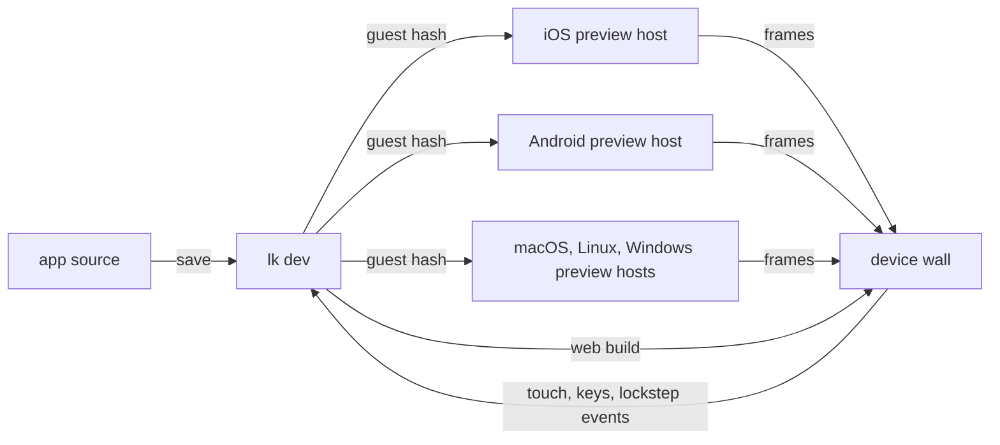

# Preview sandbox

A design for previewing one leptoskit app on every platform at once: web, iOS, Android, macOS, Windows, and Linux, side by side in one browser page, each one a real environment rather than a skin. Written 26 October 2026. The first piece is built: `lk dev` runs every platform this machine can and reloads each native app's interface in place. The device wall, lockstep, and a hosted sandbox are not.

## The problem

Before `lk dev` ran native apps, a change reached each platform through its own build: `lk dev` for the browser, `lk native build ios-simulator` and `xcrun simctl` for iOS, an APK and `adb` for Android, and a separate desktop build per OS. Checking that one screen looks right everywhere means six builds and six windows. Expo Snack solved the same problem for React Native, and leptoskit is already shaped to solve it the same way.

## How Expo Snack does it

Snack's preview is real, not simulated. Its panel has four tabs: Web, iOS, Android, and My Device.

- **iOS and Android** are [Appetize](https://appetize.io) sessions: a real iOS Simulator and a real Android emulator in Appetize's cloud, with Expo Go preinstalled, streamed to the browser as video while mouse and keyboard input is sent back. Sessions are scarce, so Snack queues users for them. Expo's CI uploads each new Expo Go build to Appetize, one per SDK version.
- **My Device** is Expo Go on your own phone, paired with a QR code.
- **Web** is a separate web player that runs react-native-web in the page.
- **The code** is bundled on demand (npm packages by a service called Snackager) and loaded by the Snack runtime inside Expo Go, which reloads whenever the code changes.

The one limit that follows from this design: Expo Go ships a fixed set of native modules, so a Snack can only use packages that need nothing else. Anything with its own native code needs a development build of the real app.

Sources: [expo/snack](https://github.com/expo/snack), [Snack's Appetize integration](https://deepwiki.com/expo/snack/6.2-appetize-integration).

## What leptoskit already has

The hard half. A native leptoskit app is a fixed shell running the interface as a Wasm guest in `wasmi` (`WasmHost<B: NativeBackend>` in `leptoskit_wasm`), and code push already replaces that guest over the air. That is the Expo Go model: a generic host plus code delivered at runtime. `ABI_VERSION` plays the role of Expo's SDK version, deciding which guests a host can run.

What is missing:

1. **A preview host.** No prebuilt shell loads a guest from a development server. The generated macOS, iOS, and Android apps draw six components through the Swift and Kotlin renderers, so they can't be the preview host; the backend crates draw everything and can.
2. **Live reload on native.** Built: `lk dev` serves each platform's guest, and debug builds of the generated apps follow it.
3. **Swapping a guest in place.** Built: `WasmHost::replace_guest` keeps the surface and its widgets, and the Swift and Kotlin shells swap a hidden candidate in once it renders.
4. **A way to see and drive every platform from one page.**

## The design

Three pieces: a preview host on each platform, `lk dev` on the developer's machine, and the device wall in the browser.

### The preview host

One app per native platform, built from the backend crates so it draws every component, and linking every first-party plugin, the way Expo Go links every Expo module. It starts paired with a preview session (a command-line argument on desktop, a deep link or QR code on mobile), downloads the guest for its platform, checks its hash, and runs it. When the server announces a new guest it swaps it in place: same window, same plugins, fresh guest state. Panics, ABI mismatches, and fuel exhaustion show as an overlay instead of closing the app, and logs from the logging plugin go back to the server.

The preview host is a separate app with its own bundle identifier. It runs unsigned guests only from a paired session, so release apps keep requiring signed code push releases; nothing about signing gets weaker.

An app with its own native plugins can't run in the shared host, exactly as with Expo Go. For those, the same preview client can be compiled into the app's own generated shell, a development build in Expo's terms.

### `lk dev`

`lk dev` runs every platform. What is built: it picks every platform in `app.platforms` this machine can run (or those named with `--platform`), finds or boots a device for each (this machine, every booted iOS Simulator, every `adb` device, or the first emulator), builds and installs each debug app once, and launches it with the guest URL (an environment variable, or an intent extra on Android). Each change rebuilds only the guests, which `lk dev` serves from a loopback server; Android reaches it through `adb reverse`. The apps long-poll one `GET` per platform (`leptoskit_codepush::dev`) and swap each new guest in. Only debug builds accept a development guest: `DevGuests::new` refuses in a release build. iOS devices, a shared preview host, and the messages below are not built.

The planned protocol grows that into a two-way channel. It watches the source, builds a guest for each platform that has a connected host (the CLI already builds one guest per platform, because each build selects one platform feature and `platform_module!` can change the tree), serves the guests by content hash, and talks to the hosts over one WebSocket per host:

| Direction     | Message                                                                                                |
| ------------- | ------------------------------------------------------------------------------------------------------ |
| host → server | `hello`: platform, host version, `ABI_VERSION`, linked plugins, viewport, scale, dark mode, locale.    |
| server → host | `guest`: URL, SHA-256, size. A host whose ABI doesn't match gets a clear refusal naming both versions. |
| host → server | `committed`, `error` (trap, fuel, ABI, invalid tree), `log`, and `event` for lockstep.                 |
| server → host | `dispatch` (a lockstep event), `control` (rotate, dark mode, locale, text size, location, sensors).    |

It prints a QR code carrying the LAN address and a random per-run session token, so a real phone running the preview host joins the same session. It builds the guest for the tile in focus first, so the platform you are looking at reloads first.

### The device wall

A browser page served by `lk dev`, with one tile per platform in a device frame. Every tile shows the real environment:

| Tile    | Real environment               | Runs locally on a Mac as                               | Pixels reach the page through                                   | Input goes back through                           |
| ------- | ------------------------------ | ------------------------------------------------------ | --------------------------------------------------------------- | ------------------------------------------------- |
| Web     | The browser                    | The dev build in an iframe                             | The iframe                                                      | The iframe                                        |
| iOS     | iOS Simulator                  | `simctl` boots a device and installs the preview host  | The simulator framebuffer, or ScreenCaptureKit window capture   | HID events through CoreSimulator, as `idb` does   |
| Android | Android emulator (arm64 image) | The SDK emulator started with `-grpc`                  | The emulator's gRPC screenshot stream                           | The emulator's gRPC touch, key, and sensor calls  |
| macOS   | AppKit on this Mac             | The preview host as a normal app                       | ScreenCaptureKit capture of its window                          | Events posted to its window, or lockstep dispatch |
| Linux   | GTK 4 in a Linux container     | Docker with `gtk4-broadwayd`                           | GTK's Broadway backend, which draws GTK into a browser natively | Broadway                                          |
| Windows | Windows 11 on Arm in Parallels | The preview host in the VM, with a small capture agent | Windows.Graphics.Capture                                        | `SendInput`, or lockstep dispatch                 |

This Mac already has Docker, Tart, and Parallels, so all six tiles can be real on one machine with no cloud. The first version sends JPEG frames over the WebSocket, which is simple and fast enough on localhost; H.264 decoded with WebCodecs can replace it later. Two honest exceptions: Wine could run the Windows host on Linux, but it draws Win32 controls in its own theme, so it isn't what Windows users see and the wall shouldn't pretend it is. And GTK documents Broadway as an experiment that gets less attention than its other backends; if it falls short, Xvfb plus window capture replaces it.

### Lockstep

The twist that Snack can't do. Every tile runs the same guest, so a press is an event on a node, and the same node exists on every tile. With lockstep on, tapping a button on the iOS tile presses that button on all six: the server forwards the semantic event (node and event payload), not screen coordinates, because the layouts differ in pixels. Typing into a field types into every field. A tile where the node is missing, because a platform module built a different tree, gets a "diverged" badge instead of a wrong tap.

The wall stops being six apps you poke one at a time and becomes one app running in six places, which is what the toolkit promises.

### Device controls

Each tile gets the controls its real environment supports: rotate on all mobile tiles; dark mode and locale everywhere; text size, location, status bar overrides, and push notifications on iOS through `simctl`; on Android, the emulator's physical model, so dragging a "tilt" handle feeds the real accelerometer and gyroscope. The iOS Simulator has no accelerometer, and the wall says so rather than faking one.

## Where it runs

**Local first.** Everything above runs on the developer's machine with `lk dev`, costs nothing to operate, and covers Expo's My Device tab too, through the QR code.

**Hosted later, as a separate decision.** A public sandbox like snack.expo.dev is an operations business, which is why Expo rents Appetize rather than running simulators itself:

- Linux tiles (GTK through Broadway, Android emulators with KVM) run on ordinary bare-metal Linux and are the cheap part.
- iOS and macOS need Apple hardware. Many iOS Simulators can share one Mac; macOS VMs through Tart are limited by Apple's licence to two per Mac.
- Windows needs one VM per session.
- The pragmatic path: rent Appetize for iOS and Android exactly as Expo does, uploading the preview host builds, and host only the Linux tile ourselves.
- Compiling a stranger's Rust runs their build scripts and proc macros, so hosted builds run in throwaway containers with no network and a warm cache of allowed crates, the way the Rust Playground works. At runtime the guest is Wasm in an interpreter with fuel limits, which is a real advantage over Expo; the hosted preview host only has to restrict plugins (no shell, a scoped filesystem, an allowlist for HTTP).

## Examples

The wall is only as good as what runs on it, and a pile of to-do clones proves nothing. Each example below is a real app that shows something the wall can prove across platforms. They need no sandbox to exist: each runs on today's native builds, so they can start in parallel with the work above.

| Example       | What it is                                                                                                   | Twist                                                                                                         | Uses                                                                    | Platforms             |
| ------------- | ------------------------------------------------------------------------------------------------------------ | ------------------------------------------------------------------------------------------------------------- | ----------------------------------------------------------------------- | --------------------- |
| Device report | Everything the app can learn about where it runs: OS, version, locale, battery, network, screen, brightness. | The wall's proof that every tile is real: six tiles, six honest answers.                                      | device, os, battery, network, brightness, localization                  | All                   |
| Tilt          | A marble you roll into a hole.                                                                               | On a phone you tilt it. On a desktop the window is the phone: drag it across the screen and the marble rolls. | accelerometer, gyroscope, haptics, keep_awake, screen_orientation       | All                   |
| Field notes   | Offline notes with search, attachments, and sharing.                                                         | Thousands of notes, scrolled smoothly on every platform.                                                      | sqlite, filesystem, document_picker, sharing, file routes, virtual list | All                   |
| Split         | Shared expenses for a trip, settled with the fewest payments.                                                | Currency and number formats follow each tile's locale.                                                        | sqlite, sharing, table, l10n                                            | All                   |
| Focus         | A focus timer.                                                                                               | On a phone it keeps the screen awake; on a desktop it lives in the tray and starts from a global shortcut.    | notifications, keep_awake, haptics, tray, global_shortcut, menu         | All                   |
| Shelf         | Clipboard history.                                                                                           | Desktop only on purpose: one instance, starts at login, remembers its window.                                 | clipboard, tray, global_shortcut, autostart, single_instance            | macOS, Windows, Linux |
| Watch         | A read-only Solana address watcher: balances, token accounts, live slot.                                     | No keys anywhere; the same live account on six screens.                                                       | http, websocket, query, table                                           | All                   |
| Trail         | A hiking log: altitude, steps, and route.                                                                    | Altitude from the barometer, not GPS.                                                                         | barometer, pedometer, location, sqlite                                  | iOS, Android          |
| North         | A compass.                                                                                                   | A haptic tick as you pass each cardinal point.                                                                | magnetometer, haptics                                                   | iOS, Android          |
| Codes         | A two-factor code app.                                                                                       | Codes are computed by the crypto plugin and locked behind the platform's own biometrics.                      | crypto, secure_store, local_authentication, clipboard                   | All                   |
| Room          | Chat against the app's own Axum server.                                                                      | One shared RPC crate drives the browser, the phones, and the desktops.                                        | websocket, rpc, server functions                                        | All                   |
| Read to me    | Reads notes or articles aloud.                                                                               | Voices and translations follow each tile's locale.                                                            | speech, l10n                                                            | All                   |

They also have to respect what exists today: `Image` loads local files only, there are no shadows, transforms, or gradients, and there is no drawing canvas, so they lean on flat, typographic design. Tilt draws its marble as a positioned rounded `View`, and how fast a guest in the interpreter can move one at 60 frames a second is an open question it will answer. Its desktop twist needs a window-moved event, which no plugin exposes yet.

## The plan

Each step is one pull request.

1. **Swap a guest in place.** Done: `WasmHost::replace_guest`.
2. **`lk dev` on every platform.** Done for the web, iOS Simulators, Android devices and emulators, macOS, Windows, and Linux, over a long-polled guest per platform. Still to do: the two-way messages above, QR pairing for phones without `adb`, and iOS devices.
3. **Desktop preview hosts.** The generated desktop apps already reload under `lk dev`. What remains is a shared host that draws every component and links every plugin, so an app runs without a build of its own; on macOS that is a Rust shell on `leptoskit_appkit`, as the gallery's window is.
4. **Mobile preview hosts.** The generated iOS and Android apps reload under `lk dev`, but draw six components. A shared host on the UIKit and Android backend crates, paired by QR code, would match Expo Go on a real phone.
5. **The wall, mobile first.** Web, iOS, and Android tiles with frame streaming and pointer input.
6. **The desktop tiles.** macOS capture, Linux through Broadway in Docker, and Windows in a Parallels VM.
7. **Lockstep and device controls.**
8. **Examples**, in batches, starting with Device report, at any point alongside the steps above.
9. **A hosted sandbox**, if and when it is worth running.

## Open questions

- **Node identity across platforms.** Lockstep assumes the same guest builds the same node IDs on every platform. That needs a test before lockstep is built, and a fallback that matches by role and accessible name.
- **State across a reload.** A reload starts the guest fresh. Keeping the route is cheap (the host can pass it back to the new guest); keeping signal state would need the guest to serialize it.
- **Build time.** Six platform guests per save is up to six incremental compiles, and cargo serializes builds in one target directory. Building only connected platforms, focused tile first, is the first answer; measure before doing more.
- **Private Simulator APIs.** iOS input goes through CoreSimulator the way `idb` does, which Xcode updates can break. That is acceptable locally and a reason to rent rather than build hosted iOS.
- **Windows on Arm.** The Parallels VM runs Windows on Arm, so the Windows host either builds for `aarch64-pc-windows-msvc` or runs as x64 under emulation; CI checks x64 today.
